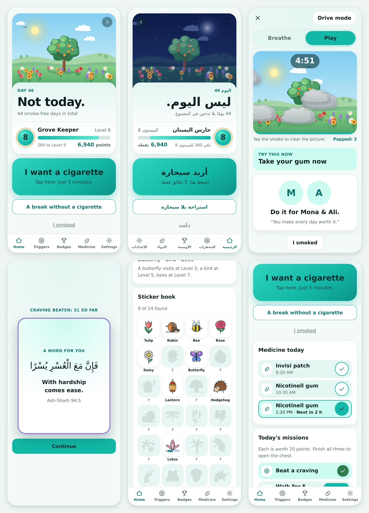

# Not Today

**A quiet, offline companion for the day you decide not to smoke.**
**ليس اليوم**



## Why it exists

Willpower alone rarely works. Most people need several attempts to quit
smoking, and the hard part is usually the same: the craving itself, the stress,
the habits wrapped around the day, and the feeling that one slip means it is
all over.

Not Today looks after the habit and motivation side. It gives you something to
do for the next five minutes, shows you your own reasons at the right moment,
and never takes your progress away. It is designed to go **with** medicine and
support from a doctor or pharmacist, not instead of them.

## Important: health note

- Not Today is **not a medical device and not medical advice**.
- Talk to a doctor or pharmacist about stop-smoking medicine and which one is
  right for you. The app only helps you remember *when*; it never gives doses.
- The built-in medicine list and the hotlines (105 and 15335) are for
  **Egypt**. Prices are from November 2026 and are not updated automatically.
  If you live somewhere else, check your local services and prices.
- If you feel unwell, or notice mood changes while taking a medicine, contact a
  doctor.

## What it does

- **Craving button.** Press it when you want a cigarette. A 5-minute timer
  starts. Breathe with the circle, or play "clear the smoke", a small game
  where you tap away the clouds before the timer ends. **Drive mode** shows big
  text and uses sounds and vibration, so you do not need to read.
- **Progress that never resets.** If you slip, you log it and carry on. Your
  smoke-free days, badges and points are not wiped. One slip is not the end,
  and starting over from zero is the main reason people give up.
- **A garden that grows.** Every craving you beat adds a flower; smoke-free
  days grow the tree. There are points, levels, badges, three small daily
  missions, and a surprise reward card after each win (a note from someone you
  love, a verse, bonus points, a sticker). Nothing is ever taken away.
- **Your reasons, at the right moment.** Money saved, how your body is
  recovering, the people you are doing it for, your own line, and optional faith
  texts (an editable Islamic starter set that you can turn off or change).
- **Triggers.** Log what sets off a cigarette (after food, coffee, the car,
  stress), see your top triggers, and pick a replacement for each.
- **Medicine times and reminders.** Tick the products your doctor or
  pharmacist gave you, set the times, and tick doses off from the home screen.
  Timing only, never amounts.
- **English and Arabic**, including right-to-left layout. Light and dark themes.

## Privacy

- No account, no server, no analytics, no network calls.
- Everything stays in the app's storage on your device.
- Back up and move your data with **export** (a JSON file) and **paste-import**
  in Settings.

## Download

Get the Android APK and the Windows installer from the
[Releases page](https://github.com/ahmedhani-az/not-today/releases).

- **Android:** the APK is installed from outside the Play Store, so you will
  need to allow installing from your browser or file manager.
- **Windows:** the installer is **not code-signed**, so Windows SmartScreen will
  show a warning. Choose "More info", then "Run anyway", if you trust it.
- **Any browser:** build it yourself (below) and open the `dist/` folder from
  any static web server.

## Build from source

Requirements: **Node 20+** and npm. For Android also JDK 21 and the Android
SDK. For the Windows installer, the `desktop/` scripts (no Windows machine or
Wine needed).

Web app (repo root):

```sh
npm install
npm run dev        # dev server
npm run build      # type-check, then build into dist/
npm test           # unit tests
```

Android APK (build the web app first):

```sh
cd mobile
npm install
npm run build      # syncs dist/ into Capacitor, then ./gradlew assembleRelease
```

The APK is signed when `mobile/keystore.properties` exists (it is gitignored)
with these keys, and unsigned otherwise:

```properties
storeFile=/path/to/release.jks
storePassword=...
keyAlias=...
keyPassword=...
```

Windows installer (build the web app first):

```sh
cd desktop
npm install
npm run dist:win
```

## Project layout

```
src/
  lib/          rules and data: progress, points, badges, store, reminders,
                translations. Pure functions, unit tested.
  screens/      one file per screen
  components/   garden art, stickers, reward card, smoke game, medicine card
mobile/         Capacitor Android wrapper
desktop/        Electron Windows wrapper
docs/design/    design docs and the original implementation plan
docs/screenshots/
```

## Design principles

- **Nothing is ever taken away.** No lives, no broken streaks, no wilting
  plants. A slip only means nothing new is added.
- **"Not today", not "forever".** The app asks for today, and for the next five
  minutes.
- **Your own words.** Your reasons, people and texts are yours; the app shows
  them back to you.
- **Simple language**, with no guilt and no lectures.

See [`docs/design/`](docs/design) for the full reasoning.

## Contributing

Issues and pull requests are welcome. Especially useful:

- translations into other languages,
- medicine lists and hotlines for other countries,
- accessibility improvements.

Before opening a pull request, run:

```sh
npx tsc --noEmit && npx vitest run
```

and please keep to the design principles above.

## Licence

[MIT](LICENSE). Copyright (c) 2026 Ahmed Hani.
